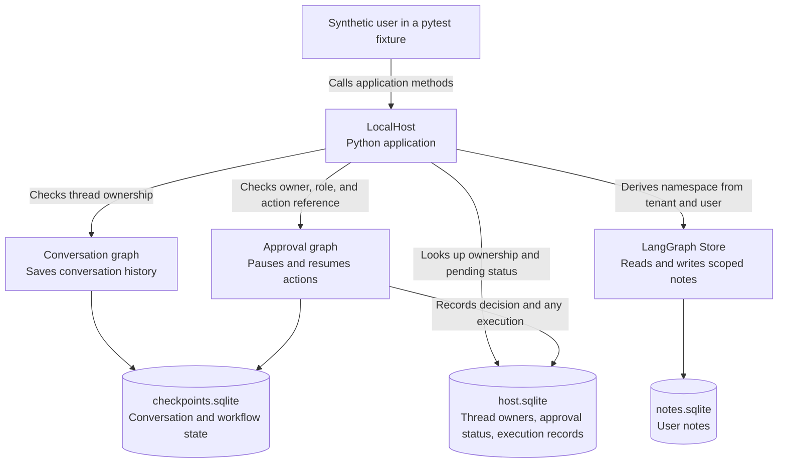
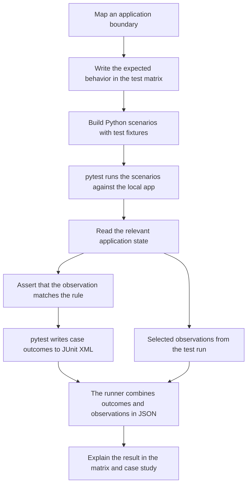

# LangGraph integration testing case study

A local Python application uses LangGraph to save conversation state and pause actions for approval. This case study checks access controls, approval rules, and recovery behavior with synthetic users and SQLite. The recorded run had **70 passes and 3 failures across 73 cases**.

[Application architecture](#application-architecture) · [Testing pipeline](#testing-pipeline) · [Results and reading order](#results-and-reading-order)

## Boundaries, tests and evidence

Read the [22 boundaries in JSON](matrices/boundaries.json) or [as a table](MATRIX.md). [Local application](lab/local_host.py), [control tests](lab/test_controls.py), and [persistence tests](lab/test_persistence.py) are included with their [setup guide](lab/README.md). [Historical results](evidence/results.json) also include the resilience checks from the larger October run.

For B09, find `test_pending_approval_has_no_effect`, `test_denial_has_no_effect`, and `test_valid_approval_records_one_dummy_effect` in the control tests. Each checks the count of synthetic execution records in SQLite.

Run the offline evidence checks from the repository root with Python 3.10 or later.

```sh
python -B -m unittest discover -s tests -v
```

These checks read saved files and do not launch the assessed application.

## Application architecture



- **LocalHost** owns the access rules. It checks thread ownership, controls who can approve a pending action, and assigns note storage by tenant and user. Test fixtures supply identities directly.
- **LangGraph** runs two graphs. One keeps conversation state. The other pauses at an approval step and resumes after the application accepts a decision.
- **SQLite** stores three kinds of data in separate files in the persistent test setup. The checkpoint tells us where a graph stopped. The notes database holds user notes. The application ledger records ownership, decisions, and a dummy execution row when an action is approved.

For an action, the host marks it pending and starts the approval graph. The graph saves its waiting state. Once the host accepts an authorized decision, the graph resumes. Approval records one dummy execution row and an approved status. Denial records a denied status and leaves zero execution rows in the ordinary denial case. The ledger and graph checkpoint are saved separately, so the tests compare both when checking recovery.

## Testing pipeline




**Worked example — matrix row B09.** An action awaiting approval or denied by the owner should leave zero execution records. Python fixtures set up the user and the action. pytest runs the pending and denial scenarios and checks the ledger. A separate approval scenario expects one record and confirms that the test action can run. A negative control feeds the assertion an unexpected dummy row and verifies that it rejects that result.

| Scenario | What the test checks |
| --- | --- |
| Action is pending | Zero execution rows |
| Owner denies the action | Zero execution rows |
| Authorized owner approves the action | One execution row |

pytest writes each case outcome to JUnit XML. The local runner reads the XML and combines those outcomes with selected observations in JSON. This repo includes an extract of the recorded results and the documents that explain them. The repository includes the local control and persistence suites. The larger historical run also included separate resilience checks. [Recorded results](evidence/results.json)

## Results and reading order

The October 24, 2026 local run had **70 passes and 3 failures**. A repeat of nine cases produced **6 passes and the same 3 failures**. The failed checks concern the synthetic application's consistency between approval status, execution attempts, and saved state.

1. Read the architecture and pipeline above to see what was tested and how.
2. Open the [case study](CASE-STUDY.md) for the negative controls and the three failed checks.
3. Use the [matrix](MATRIX.md) to trace the 22 properties. Start with B09 for the approval example and B18, B20, and B21 for the failures.
4. Open the [recorded results](evidence/results.json) for totals and individual case outcomes. The [detailed pipeline notes](PIPELINE.md) walk through each stage.
